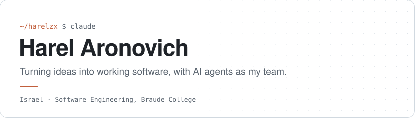

<picture>
  <source media="(prefers-color-scheme: dark)" srcset="assets/header-dark.svg">
  
</picture>

 

**I decide what to build and why. Agents help me ship it fast. I make sure it actually works.**

## How I work with agents

I'm not here to prompt and hope. I treat everything around the model as part of the engineering:

- **Harness and context** - instructions, specs and runbooks, so every session starts knowing the rules.
- **Skills** - work I repeat becomes a skill, done the same way every time.
- **MCP** - agents connected to the real tools a project lives in.
- **Planning before building** - shape the idea first, then split the work across subagents.
- **Verification over vibes** - nothing counts as done until it's tested and measured.
- **Under the hood** - how the agent loop works: tool calls, context, and where agents go wrong.

## Featured

<table>
<tr>
<td width="55%" valign="top">

### [AirClicker](https://github.com/Harelzx/airclicker)

**Your AirPod is now a presentation clicker.** Hold it, flick your wrist, and the slide changes. A macOS menu bar app that reads the AirPods motion sensors and presses the arrow key for you.

Built in 15 minutes before a lesson, then tuned on 159 logged flicks.

`Swift` `CoreMotion` `macOS`

</td>
<td width="45%" valign="middle" align="center">

</td>
</tr>
</table>

## What I build with

### Agents and tooling

 

### Languages and platforms

## Let's talk

Building something with agents, or want to compare notes on how you work with them? I'd love to hear about it.

